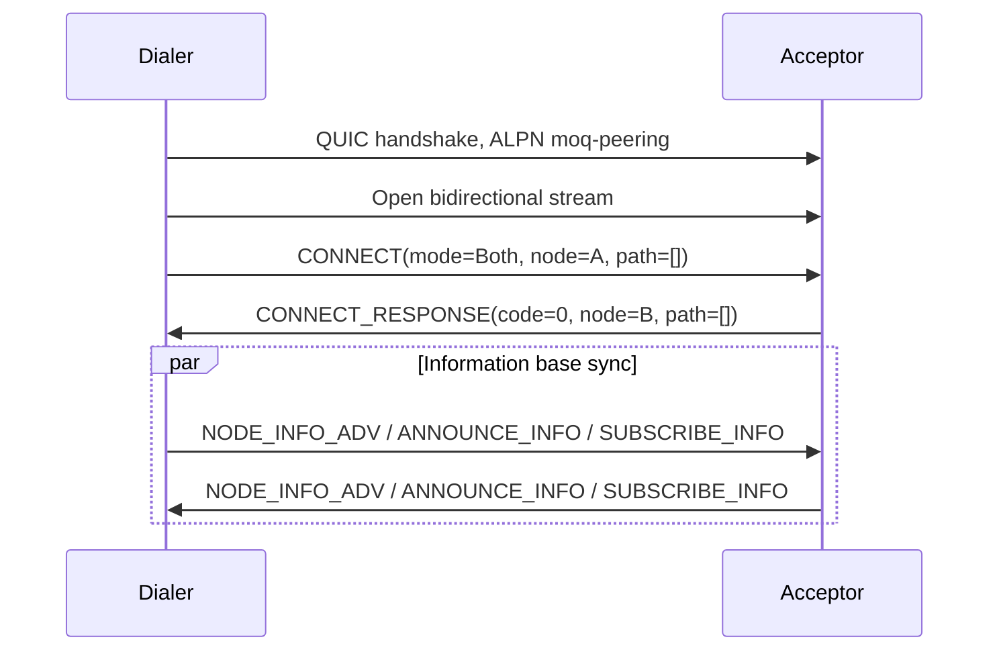

# Peering protocol

This is the relay-to-relay protocol implemented by `moq-peering`. Relays exchange reachability, announcements, subscribes, and objects over one QUIC session. An application such as [LAPS](https://github.com/Quicr/laps) implements Media Over QUIC and calls the library. The library does not open a MoQ session.

The application API is [api.md](api.md). Integer fields below are big-endian except the node-path record, which is copied in native byte order. `varint` is the variable-length integer in `src/peering/uintvar.h`. A length from 0 through 63 is a single byte equal to that length.

## Contents

- [Scope](#scope)
- [Transport](#transport)
- [Node identity](#node-identity)
- [Node types](#node-types)
- [Sessions](#sessions)
- [Node information](#node-information)
- [Names and hashes](#names-and-hashes)
- [Announcements](#announcements)
- [Subscribes](#subscribes)
- [Path selection](#path-selection)
- [Subscriber node sets](#subscriber-node-sets)
- [Objects](#objects)
- [Messages](#messages)
  - [Common control header](#common-control-header)
  - [Connect](#connect)
  - [Connect response](#connect-response)
  - [Node information](#node-information-1)
  - [Subscribe information](#subscribe-information)
  - [Announce information](#announce-information)
  - [Subscribe node set](#subscribe-node-set)
  - [Data header](#data-header)

## Scope

Every connected session carries control messages and objects. The session mode on the wire is `Both`.

`PeerMode` also defines information-base-only (`0`) and data-only (`1`). `Connect` always sends `Both` (`2`). The received mode is logged and does not change what the session forwards.

Via, Edge, and Stub are advertised so a peer can see the role. Forwarding of nodes, announcements, subscribes, and objects is the same for all three. A stub remains a node in the information base of every relay that hears it.

These behaviors are outside the current library:

- A separate control-plane session, or several data sessions beside one control session
- Rewriting a stub so the rest of the network sees only its parent edge
- Opening peers on demand, probing reachability, or applying an administrative policy to an advertisement
- Redirecting a client with a MoQ GOAWAY
- Carrying a raw MoQ subscribe or a raw MoQ parameter block

## Transport

QUIC connections use the ALPN `moq-peering`. Each node presents the certificate and key loaded from the paths in its configuration. The endpoint does not configure a trust anchor, so the peer certificate is not validated. Certificate and key bytes stay in those files.

The dialing node opens one bidirectional stream at priority 0 and sends `CONNECT` on it. The accepting node treats that bidirectional stream as the control stream and answers with `CONNECT_RESPONSE`. Later control messages use the same stream. An inbound bidirectional stream replaces the control stream the session will write.

Objects use unidirectional streams and datagrams. A bidirectional stream is control. The common control header is not placed on an object.

The transport idle timeout is 5000 milliseconds. The maximum datagram frame size offered by the endpoint is 1280 bytes. Closing a QUIC connection uses application error code 0. The protocol response codes below are only for `CONNECT_RESPONSE`. An unrecognized control type is skipped. A control message that cannot be parsed clears the control buffer for that session.

## Node identity

`Config::node_id` is a string. It is copied into node information as the contact. The numeric node id is `std::hash<std::string>{}(node_id)` and does not change after startup. Give every node a distinct string. The forwarding tables key on the numeric id.

`FormatNodeId` prints a numeric id as `high.high:low.low`, four 16-bit fields. `NodeId` can parse strings such as `1.2:1234` and `100.2:9001.2001`. Configuration does not use that parser. The contact remains the original `node_id` string.

Latitude and longitude are on the wire and are sent as `0`. Configuration has no location fields.

## Node types

| Name | Value | Advertised role |
| --- | --- | --- |
| Via | 0 | Forwards between relays |
| Edge | 1 | Relay that also has clients. This is the default |
| Stub | 2 | Stub edge |

The type is a byte in node information. It does not select a different forwarding path.

## Sessions

Either side may dial. Two relays that dial each other at the same time keep both sessions. Each session has its own control stream, its own subscriber node sets, and its own objects. There is no election that keeps a single control session.

`CONNECT` is the first control message from the dialer. `CONNECT_RESPONSE` is the first control message from the acceptor. On success the acceptor copies the dialer's node information into the session and both sides sync:

1. Node information already stored, except this node, the remote node, and any node whose path already contains the remote node. The sender appends one path hop for this session before sending.
2. Announcements whose source is not the remote node.
3. Subscribes whose source is not the remote node. Sync does not advance the subscribe sequence.

A subscribe whose source node is this node is ignored when it arrives. That drops an echo of a subscribe this node originated.

When a session disconnects, node information learned only through it is withdrawn. Subscribes whose source is no longer in the node table are withdrawn. Subscriber node sets for that session are dropped. Announcements from other nodes are removed when no session remains connected. This node's own announcements stay and are sent again on the next handshake.

## Node information

Node information describes one relay and the path the advertisement has already traveled. A direct advertisement, including `CONNECT` and `CONNECT_RESPONSE`, has an empty path.

| Field | Meaning |
| --- | --- |
| `id` | Numeric node id |
| `type` | Via, Edge, or Stub |
| `contact` | `Config::node_id` of that node |
| `longitude`, `latitude` | Present on the wire. This library sends `0` |
| `metric` | Cost of this node. Default `100`. Lower sums are preferred |
| `path` | Hops that forwarded this advertisement, in order. Empty for a direct advertisement |

Each path hop is a packed 24-byte record: node id of the relay that forwarded the advertisement (8), smoothed RTT in microseconds of the session that delivered it to that relay (8), and the metric that relay advertised on the session it is now using to forward (8). The record is copied in native byte order.

The metric written into this node's own advertisements on a session is the session metric when that value is greater than the node metric. Otherwise it is the node metric. Changing the session metric re-advertises this node and the nodes already reached through that session.

A receiver stores the advertisement under the pair `(node id, session)`. It forwards the advertisement when the selected path changes, or when the selected path is this session and the advertisement itself changed. Before forwarding, it appends a hop for itself. It does not send the advertisement to the node being described, or to a node already listed in the path.

A withdraw names the full node information. The receiver drops the path learned on that session. The withdraw is forwarded only when no other session still reaches that node. Another path is selected for subscribers that were using the withdrawn session. Objects already on an open subgroup stream stay on the previous session until that stream ends. A new stream and a datagram use the new session.

`SumMetric` is the node metric plus the metric on each hop. `SumSrtt` is the sum of the hop RTT fields. A direct advertisement has `SumSrtt` 0. The RTT of the direct session is written into the hop when this node forwards the advertisement, so the next relay sees it.

After a source node leaves the node table, subscribe sequences for that source are kept for 30 seconds. This node's own sequences are kept until the process exits. The origin also writes them next to the configured certificate, in `subscribe-seq-<node id>`, or under the system temp directory when the certificate path has no directory. The file is local state. It is not a protocol message. A version 2 file stores the track hash, epoch, and sequence so a restart continues the counter.

## Names and hashes

A name is an ordered list of namespace tuples, then a track name. The bytes are opaque. A namespace announcement leaves the track name empty.

Hashes are CityHash64, the same function LAPS uses with libquicr.

| Hash | Input |
| --- | --- |
| Tuple | CityHash64 of that tuple's bytes |
| Namespace | CityHash64 of the first tuple. Each following value is CityHash64 of the previous hash, written as 8 big-endian bytes, followed by the next tuple. An empty namespace hashes zero bytes |
| Name | CityHash64 of the name bytes. An empty name hashes zero bytes |
| Full name | `hash_combine` of `0` with the namespace hash, then with the name hash |

`hash_combine` updates `seed` with `seed ^= value + 0x9e3779b9 + (seed << 6) + (value >> 2)`.

`PeerManager::HashTrack` returns the full-name hash. Object headers, subscribes, and the application API use that value.

Two namespaces share a prefix when every tuple hash of the shorter one equals the tuple hash at the same index in the longer one. Order matters. A local announcement reports each stored remote subscribe that shares a prefix, in either direction, through `Delegate::OnPeerSubscribe`.

## Announcements

An announcement advertises one track or one namespace. The originating node sets `source_node_id` to itself. Bit 0 of `flags` is set for a namespace and clear for a track.

There is no sequence number. A receiver stores the announcement by full-name hash and source. The same pair is not forwarded again. A withdraw removes that pair. A withdraw for a pair that is not stored is not forwarded.

The announcement carries the namespace bytes and the name bytes, so the next relay can rebuild the name and the hashes. The full-name hash on the wire is the hash the origin computed.

A withdraw that arrives after the source node is already gone is applied to the table and is not delivered to the local delegate. An explicit withdraw from a source that is still reachable is delivered as `OnPeerTrack` or `OnPeerNamespace`.

## Subscribes

A subscribe names one track and the parameters used to forward it. The originating node sets `source_node_id` to itself.

| Field | Meaning |
| --- | --- |
| `epoch` | Names the sequence counter. This library sends `0` unless a saved counter restores another epoch |
| `seq` | Order of advertisements and withdrawals inside that epoch |
| `source_node_id` | Node that originated the subscribe |
| `namespace_hash`, `name_hash`, `fullname_hash` | The three hashes above |
| `priority` | Copied onto a new object stream as the QUIC priority |
| `delivery_timeout` | Milliseconds. `0` leaves it unset |
| `expires` | Milliseconds. `0` leaves it unset |
| `forward` | Non-zero asks the next hop to forward objects. Zero pauses forwarding |
| `new_group_request_id` | Present only when the subscriber is asking for a new group |
| namespace and name bytes | Original tuples and track name |

Only the origin increments `seq`, once per advertisement and once per withdrawal it sends. A relay that forwards the message leaves `seq` unchanged. Sync to a new session also leaves it unchanged. `65535` wraps to `0` in the same epoch.

A receiver compares sequences only when the epochs are equal. The unsigned distance `(received - stored) mod 65536` is newer for distances 1 through 32767, so `0` is newer than `65535`. An equal or older sequence is a delayed update and is ignored. A different epoch is ignored while the stored epoch is kept.

A withdrawal carries the next sequence. The receiver keeps that sequence after the subscribe entry is gone, so a delayed older advertisement cannot restore it.

While the 30-second retention interval above is running, a greater sequence in the same epoch is what cancels it. A subscribe dropped because its source left the node table can be stored again if the same sequence is advertised once the source is reachable and the withdrawal flag was not set.

The namespace bytes and the name are encoded after the fixed fields. See [Subscribe information](#subscribe-information).

## Path selection

For each remote node the forwarding table keeps one session. A candidate replaces the current session when it wins the first test below:

1. Lower cost. The cost is `SumMetric` plus, when the next-hop session metric is greater than the node metric, the difference between those two values.
2. Equal cost and fewer hops. The hop count is the path length. A direct peer has length 0.
3. Equal cost, equal hop count, and a lower `SumSrtt`.

Equal cost, hop count, and `SumSrtt` keep the session already selected. A repeated advertisement does not move streams.

When a better session is chosen, objects already on an open subgroup stream stay on the previous session until that stream ends. A datagram and a new stream use the selected session. An egress that is only finishing old streams is skipped for a datagram and for a new stream.

## Subscriber node sets

A subscriber node set (SNS) tells one session which nodes should receive the objects that follow. It is consumed by that session. It is not forwarded unchanged.

The sender allocates the SNS id. The id is a `uint32`, starts at 1, and increases by one. `0` means unset and is skipped when the counter wraps. The counter wraps after `0xFFFFFFFE` back to 1. The same id is updated when nodes are added or removed, so a stream that already carries that id stays valid.

The set is built per egress session:

- The origin groups subscriber source nodes by the session path selection chose for each source. One SNS on that session lists those sources. The full-name hash is not in the SNS. It is in the object header.
- A relay that receives an SNS looks up each listed node. It adds that node to an egress SNS on the session selected for the node, and advertises that egress SNS. If the list contains this node, objects for a track this node has subscribed to are delivered locally.
- Removing the last node withdraws the SNS id. Removing one node sends the same id with the smaller set.
- An egress that still has open streams is kept until those streams end. New streams and datagrams follow the updated set.

Objects that arrive before the SNS is known are held on the session and forwarded when the advertisement arrives. The hold ends when the session is dropped. There is no separate buffer timer.

## Objects

An object is the application payload plus a peering header on a datagram and on the first bytes of a unidirectional stream. Later bytes on that stream have no peering header. The payload is not a MoQ message. The library does not parse it.

`group_id` and `subgroup_id` are not on the wire. The sender uses the pair to choose which local stream to write. The next hop maps that ingress stream to one egress stream.

| `DataType` | Value | Where it is sent |
| --- | --- | --- |
| `kDatagram` | 0 | One unreliable datagram. The header is 14 bytes |
| `kExistingStream` | 1 | Bytes on a stream that already started. No header is written |
| `kNewStream` | 2 | First bytes of a new unidirectional stream. The header is 19 bytes |

`kControlSignaling`, `kFetchNewStream`, and `kFetchExistingStream` are enumerators and are not sent.

`ttl` is milliseconds and is carried on a new stream. `priority` is the QUIC priority of a stream this node opens.

On fan-out of a datagram or a new stream, the SNS id at byte offset 2 is replaced with the egress SNS id. The rest of the datagram, and the rest of a stream, is copied through. The local subscriber receives the payload with the peering header removed.

A datagram is delivered with `is_new_stream` false and no stream id. The first object on a QUIC stream is delivered with `is_new_stream` true. `OnPeerStreamClosed` follows when that stream ends. `reset` is true when the peer reset it.

## Messages

Control messages start with the common header. The length in that header is the number of bytes after it.

### Common control header

```text
COMMON_CONTROL_HEADER {
    protocol_version(1) = 1,
    message_type(2),
    message_length(4),
}
```

The version byte is read and is not checked.

| Type | Name |
| --- | --- |
| 1 | `CONNECT` |
| 2 | `CONNECT_RESPONSE` |
| 3 | `DATA_OBJECT`, reserved. Objects do not use this header |
| 4 | `NODE_INFO_ADV` |
| 5 | `NODE_INFO_WD` |
| 6 | `SUBSCRIBE_INFO_ADV` |
| 7 | `SUBSCRIBE_INFO_WD` |
| 8 | `ANNOUNCE_INFO_ADV` |
| 9 | `ANNOUNCE_INFO_WD` |
| 10 | `SUBSCRIBE_NODE_SET_ADV` |
| 11 | `SUBSCRIBE_NODE_SET_WD` |

### Connect

```text
CONNECT {
    COMMON_CONTROL_HEADER type = 1,

    peer_mode(1) = 2,          // Both
    NODE_INFO,                 // path length 0
}
```

### Connect response

```text
CONNECT_RESPONSE {
    COMMON_CONTROL_HEADER type = 2,

    response_code(2),

    [NODE_INFO],               // present when response_code is 0
}
```

| Code | Name |
| --- | --- |
| 0 | No error. Node information follows. This is the code the library sends |
| 1 | Connect error. Node information is omitted |
| 2 | Not authorized. Node information is omitted |

A non-zero code is parsed and the handshake stops. The library does not send code 1 or 2.

### Node information

`NODE_INFO` is the body of `CONNECT`, of a successful `CONNECT_RESPONSE`, and of types 4 and 5. Types 4 and 5 add the common header and use the same body. A withdraw uses type 5.

```text
NODE_INFO {
    id(8),
    type(1),                   // 0 Via, 1 Edge, 2 Stub
    contact_len(varint),
    contact(contact_len),
    longitude(8),              // IEEE-754 binary64
    latitude(8),
    metric(8),
    path(24 * hops) {
        id(8),                 // native byte order
        srtt_us(8),
        metric(8),
    },
}
```

The path is every remaining byte of the message, 24 bytes per hop. A direct advertisement has no path bytes.

### Subscribe information

Types 6 and 7 use the same body. A withdraw uses type 7.

```text
SUBSCRIBE_INFO {
    COMMON_CONTROL_HEADER,

    epoch(2),
    seq(2),
    source_node_id(8),
    namespace_hash(8),
    name_hash(8),
    fullname_hash(8),
    priority(1),
    delivery_timeout(8),       // milliseconds
    expires(8),                // milliseconds
    forward(8),
    new_group_present(1),      // 1 when the next field is present
    [new_group_request_id(8)],
    NAME,
}
```

```text
NAME {
    tuple_count(1),
    tuples(tuple_count) {
        tuple_len(2),
        tuple(tuple_len),
    },
    name_len(2),
    name(name_len),            // omitted when name_len is 0
}
```

`tuple_count` is one byte, so a name has at most 255 tuples. Each tuple length and the name length are `uint16`.

### Announce information

Types 8 and 9 use the same body. A withdraw uses type 9. Bit 0 of `flags` is 1 for a namespace and 0 for a track.

```text
ANNOUNCE_INFO {
    COMMON_CONTROL_HEADER,

    source_node_id(8),
    fullname_hash(8),
    NAME,
    flags(1),
}
```

### Subscribe node set

```text
SUBSCRIBE_NODE_SET_ADV {
    COMMON_CONTROL_HEADER type = 10,

    id(4),
    priority(1),
    node_count(2),
    node_id(8) * node_count,
}
```

```text
SUBSCRIBE_NODE_SET_WD {
    COMMON_CONTROL_HEADER type = 11,

    id(4),
}
```

`node_id` values are the subscriber nodes that should receive the objects, not the relays to traverse. The set is ordered only by the numeric id, because the sender stores it as a set.

### Data header

A datagram and the start of a stream begin with `header_len`, which counts every byte of the peering header, including itself. The payload starts at that offset. There is no separate payload length. A datagram ends at the QUIC datagram. A stream continues until the peer finishes or resets it.

```text
DATA_DATAGRAM {
    header_len(1) = 14,
    type(1) = 0,
    sns_id(4),
    fullname_hash(8),
    payload(...),
}
```

```text
DATA_NEW_STREAM {
    header_len(1) = 19,
    type(1) = 2,
    sns_id(4),
    fullname_hash(8),
    priority(1),
    ttl(4),                    // milliseconds
    payload(...),              // first object on the stream
}
```

Later objects on that stream are payload bytes only.

| Data type | Header bytes |
| --- | --- |
| Datagram | 14 |
| New stream | 19, once, at the start of the stream |
| Existing stream | 0 |

## Connection establishment



After the sync, a subscribe that matches a local announcement builds an SNS on the selected session. Object datagrams and streams follow on that same QUIC connection, addressed by the SNS id in the data header.
